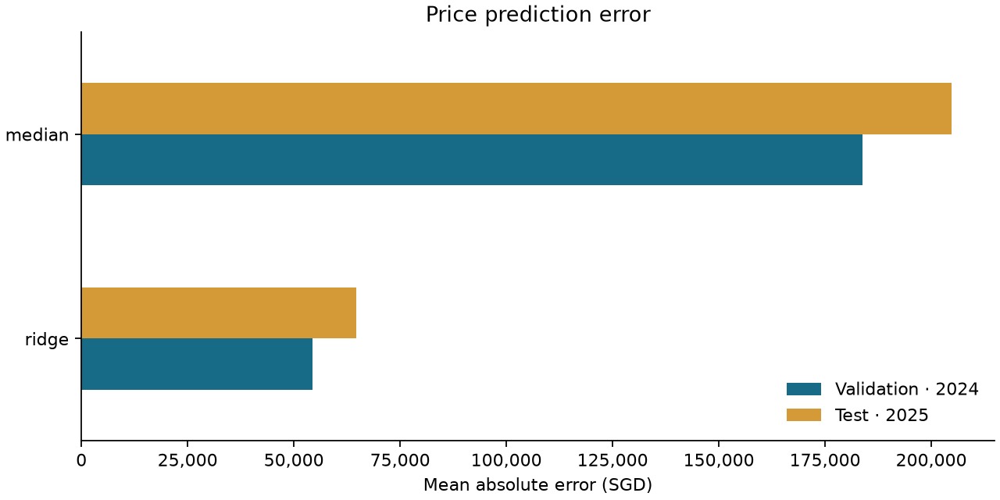

# HDB resale price prediction

Predict individual Singapore HDB resale prices from property attributes and
transaction month. A reproducible ML engineering case study with chronological
evaluation, tested Python modules, and thin explanatory notebooks.

## Results

Frozen snapshot: **202,399 transactions**, January 2017–March 2025.
Training ends in 2023; validation uses 2024; testing uses 5,414 transactions from
January–March 2025. Configurations are fixed before test evaluation.

| Model | Validation MAE (SGD) | Test MAE (SGD) | Test RMSE (SGD) | Test R² |
| --- | ---: | ---: | ---: | ---: |
| Median | 183,802 | 204,700 | 267,294 | -0.833 |
| Ridge | 54,325 | 64,631 | 85,068 | 0.814 |

Ridge reduces test MAE by about 68% relative to the constant baseline. Its larger
test error than validation error is a reminder that later transactions can differ
from the training period. These are historical results, not current valuations.



## Read the project

1. [Data exploration](notebooks/01_exploration.ipynb): snapshot, features, and split decisions.
2. [Baselines](notebooks/02_baselines.ipynb): median, Ridge, evaluation, and prediction.
3. [Design](docs/design.md): architecture, original defects, and delivery contract.

```text
src/hdb_resale/   validation, features, models, experiments, plots, CLI
notebooks/       explanations and calls into the shared package
tests/           behavioural tests and synthetic fixtures
reports/         compact measured results and figures
data/            snapshot manifest; raw CSV is ignored
artifacts/       generated model bundles and per-row predictions (ignored)
archive/         local originals (ignored; also preserved in Git history)
```

Data flows through validation, chronological splitting, fitted preprocessing,
training, persistence, and evaluation. Notebooks and CLI commands use the same
functions. Inference never requires the observed resale price.

## Run locally

Verified with Python 3.13.5 on Windows. From the repository root:

```powershell
python -m venv .venv
.\.venv\Scripts\Activate.ps1
python -m pip install -r requirements-lock.txt
python -m pip install --no-build-isolation -e .
python scripts/restore_snapshot.py
python -m hdb_resale train --data data/raw/resale.csv --model median --output artifacts/median
python -m hdb_resale train --data data/raw/resale.csv --model ridge --output artifacts/ridge
python -m hdb_resale evaluate --data data/raw/resale.csv --bundle artifacts/median
python -m hdb_resale evaluate --data data/raw/resale.csv --bundle artifacts/ridge
python -m hdb_resale compare artifacts/median artifacts/ridge
python -m hdb_resale predict --bundle artifacts/ridge --input examples/flats.csv --output artifacts/predictions.csv
```

On Linux/macOS, activate with `source .venv/bin/activate`. Use a new output
directory when retraining: existing runs are never overwritten. The example
input contains synthetic flats to demonstrate the interface, not benchmark rows.
Open notebooks with the `.venv` interpreter in your notebook editor. The development
lock includes the kernel and execution tools, not a Jupyter web server.

The snapshot restoration script reads the exact CSV from the original Git commit
and verifies its SHA-256. It requires full Git history containing `e45aff1`.
If using a source ZIP or shallow clone, obtain the documented snapshot separately
or use `tests/fixtures/transactions.csv` for a synthetic smoke run. Do not substitute
a newer download and claim the same results. See [data notes](data/README.md).

## Methodology

- Numeric: transaction month, floor area, lease commencement year, remaining lease
  in months, and lower/upper storey bounds.
- Categorical: town, flat type, street, and flat model. Block is excluded initially.
- Ridge: scaled numeric inputs, one-hot categories, `alpha=1`, `solver="lsqr"`.
- Preprocessing is fitted only on training rows. Unknown categories are supported;
  malformed required fields raise errors instead of fabricated defaults.
- Identical recorded rows remain: no transaction identifier establishes duplication.
- Model bundles store configuration, preprocessing, feature order, versions, seed,
  dataset fingerprint, split dates, and validation metrics. Load only trusted bundles.
- Subgroup MAE/RMSE/R² and counts are saved for month, town, flat type, and storey.

## Checks

```powershell
python -m ruff check .
python -m ruff format --check .
python -m pytest -q
python scripts/check_notebooks.py
```

CI runs checks and synthetic notebook execution on Windows and Linux. Full-data
training is local. See [contributing](CONTRIBUTING.md) for test-first development,
PEP 8 conventions, and Conventional Commits.

## Limitations and next experiments

- March 2025 may be incomplete. The snapshot's original retrieval date is unknown.
- The original project already examined 2025: this is a corrected historical
  holdout, not an untouched prospective test.
- Transaction mix and market conditions change. No claim of causal effects,
  future market forecasting, or present-day valuation accuracy is made.
- No coordinates, nearby amenities, or external economic features are included.
- Boosted trees are next. Optional MLP and feature-sequence LSTM comparisons come
  after the baseline release; their original scores are not reused.

The original Colab notebooks are preserved in Git history. Their preprocessing
leakage, inconsistent inference, and training-loss checkpoint selection are
documented in the design note rather than presented as reliable results.
