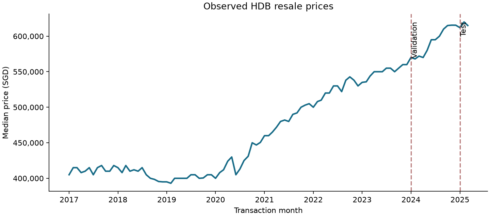
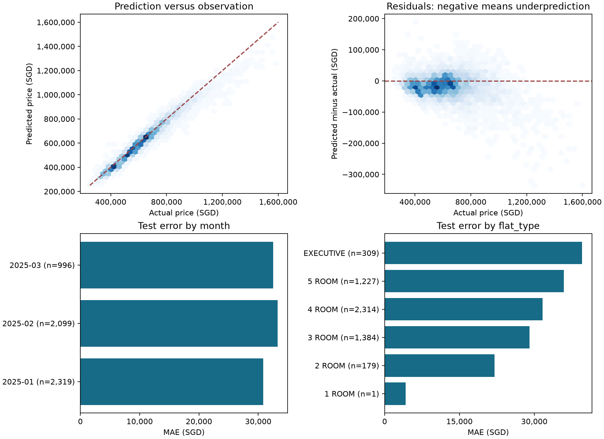

# HDB resale price prediction

Predict individual Singapore HDB resale prices from property attributes and month.
A reproducible ML portfolio: validated inputs, shared Python pipelines, chronological
splits, tested inference, and six executed notebooks with saved analysis and figures.

## Results

**202,399 transactions, January 2017–March 2025.** Train through 2023, select using
2024 validation MAE, evaluate on 5,414 transactions from January–March 2025.

| Model | Validation MAE | Test MAE | Test RMSE | Test R² | Fit time |
| --- | ---: | ---: | ---: | ---: | ---: |
| Median | S$183,802 | S$204,700 | S$267,294 | -0.833 | 4 s |
| Ridge | S$54,325 | S$64,631 | S$85,068 | 0.814 | 9 s |
| Boosted trees | S$36,909 | S$60,779 | S$73,295 | 0.862 | 15 s |
| MLP | S$27,130 | S$32,090 | S$44,860 | 0.948 | 115 s |
| Feature-sequence LSTM | S$85,409 | S$98,478 | S$124,076 | 0.605 | 846 s |

The MLP wins on validation MAE; its test MAE is about 84% below the median baseline.
Ridge and trees provide useful results in seconds. The bounded LSTM run is slower
and weaker. MAE is average dollar error; RMSE emphasizes large misses; R² is not
percentage accuracy. Timings are hardware-dependent CPU measurements.

## Analysis

[Exploration](notebooks/01_exploration.ipynb) covers data quality, repeated rows,
price distributions, transaction mix, and chronological split summaries.
[Comparison](notebooks/06_comparison.ipynb) examines residuals and errors by month,
flat type, and town, including group counts. Each model notebook includes test
error figures; neural notebooks also show learning curves.

Monthly medians reflect both market changes and transaction mix. Every model's
test MAE exceeds validation MAE. The MLP underpredicts by S$18,493 on average;
executive-flat MAE is S$39,582 (309 sales), versus S$31,659 for 4-room flats
(2,314 sales). Sparse groups need caution: the test contains just one 1-room sale.

## Explore or reproduce

- Experiments: [baselines](notebooks/02_baselines.ipynb),
  [trees](notebooks/03_boosted_trees.ipynb), [MLP](notebooks/04_mlp.ipynb),
  [LSTM](notebooks/05_lstm.ipynb).
- [Setup, commands, configurations, and checks](docs/running.md).
- [Architecture and corrected original defects](docs/design.md),
  [data provenance](data/README.md), [contributing conventions](CONTRIBUTING.md).

`src/hdb_resale/` owns validation, features, training, persistence, and evaluation;
notebooks and the CLI call the same functions. Raw data and model binaries stay
local; compact reports and executed notebooks are committed. Restore the exact CSV
from Git history with `python scripts/restore_snapshot.py` after installation.

## Limits

One historical split and seed; March 2025 may be incomplete, and the original work
already inspected 2025. The LSTM processes feature positions, not transaction
history, and its five-epoch budget differs from the MLP's 20-epoch ceiling.
No claim of present-day valuation accuracy, causal effects, or deployed service.
